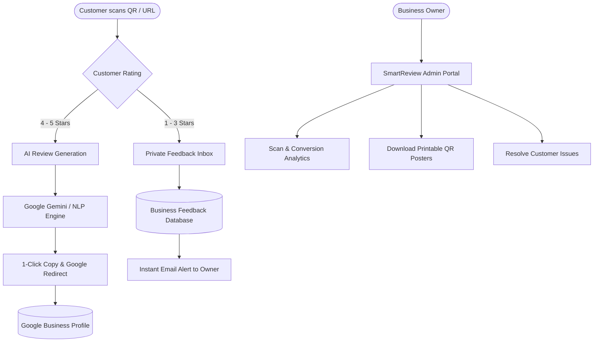

# SmartReview — AI-Powered Customer Review Management System

> **College Minor Project**  
> **Student / Author:** Hardik ([@Hardik637](https://github.com/Hardik637))  
> **Repository:** [https://github.com/Hardik637/smartreview](https://github.com/Hardik637/smartreview)  
> **Deployment:** Hosted on Vercel  

---

## 📌 Project Overview

**SmartReview** is an AI-powered customer feedback and review acceleration platform engineered to help businesses enhance their online reputation, capture authentic customer sentiment, and systematically manage feedback.

In modern commerce, prospective customers rely heavily on Google Reviews and ratings before making purchase decisions. However, satisfied customers frequently leave without posting a review due to friction, lack of inspiration, or busy schedules, while dissatisfied customers often vent publicly.

**SmartReview** addresses this problem through an intelligent **review deflection & generation pipeline**:
1. **QR & NFC Touchpoints**: Customers scan custom dynamic QR codes or touch NFC tags placed on counters, tables, packaging, or receipts.
2. **Sentiment Routing (Smart Filtering)**:
   - **Positive Experiences (4–5 Stars)**: Routed to the **AI Review Assistant**, which helps customers generate well-articulated, authentic reviews in their preferred tone and keywords, copied with 1-click and redirected directly to Google Reviews.
   - **Critical Feedback (1–3 Stars)**: Gracefully deflected to a **Private Customer Feedback Channel**, sending an alert to the business owner to resolve complaints privately before they hurt public ratings.
3. **Business Command Center**: Analytics dashboard, review rate monitoring, customizable review topics, QR studio with PDF/poster generation, and automated feedback management.

---

## 🚀 Key Features

- 🤖 **AI-Assisted Review Generator**: Integrates Google Gemini API (with a built-in zero-dependency NLP fallback engine) to draft personalized, contextual reviews in seconds based on customer-selected tags and sentiments.
- ⭐ **Intelligent Sentiment Gatekeeper**: Automatically splits high-satisfaction customers to Google Reviews while routing dissatisfied feedback to internal business inboxes.
- 📱 **QR Code Studio & Printable Collateral**: Generates high-resolution vector QR codes, branded printable table tents, flyers, and download-ready PDF posters via client-side PDF rendering.
- 📊 **Real-time Analytics Dashboard**: Tracks scan rates, sentiment distributions, conversion rates (scan-to-review), and keyword popularity trends.
- 🏢 **Multi-Category Business Profiling**: Tailored review topics and prompts for cafes, restaurants, clinics, salons, auto shops, retail, and corporate services.
- 💳 **Subscription & Plan Management**: Razorpay payment gateway integration with built-in sandbox mock fallback for development and grading evaluation.
- 🔒 **Security & Authentication**: Secure JWT session authentication, bcrypt password hashing, reset token expiry, and strict API rate limiting.
- 📱 **Fully Responsive Academic Design**: Optimized layout across mobile phones (360px+), tablets (768px+), and desktop displays (1440px+).

---

## 🛠️ Technology Stack

| Layer | Technologies |
| :--- | :--- |
| **Frontend Framework** | [Next.js 14](https://nextjs.org/) (App Router, Server Components & Client Hooks) |
| **Language** | [TypeScript](https://www.typescriptlang.org/) (Strict typing across APIs & schemas) |
| **Styling & Design** | [Tailwind CSS](https://tailwindcss.com/) with Lucide Icons and Framer Motion |
| **Database & ORM** | [Prisma ORM](https://www.prisma.io/) with SQLite (local development) / PostgreSQL (production ready) |
| **Artificial Intelligence** | [Google Gemini 1.5/2.0 API](https://aistudio.google.com/) (`@google/generative-ai`) + Smart Fallback NLP |
| **Payment Gateway** | [Razorpay](https://razorpay.com/) SDK with signature verification and mock test mode |
| **QR Code & PDF** | `qrcode`, `jspdf`, `canvas-confetti` |
| **Email Service** | `nodemailer` with SMTP configuration for alerts and password resets |
| **Deployment Platform** | [Vercel](https://vercel.com/) (Edge-ready Next.js Serverless architecture) |

---

## 🏗️ System Architecture



---

## 💻 Local Development Setup

### 1. Prerequisites
- **Node.js**: `v18.17.0` or higher (tested with Node 20 / 22 / 26)
- **npm** or **pnpm**
- **Git**

### 2. Clone the Repository
```bash
git clone https://github.com/Hardik637/smartreview.git
cd smartreview
```

### 3. Install Dependencies
```bash
npm install
```

### 4. Configure Environment Variables
Copy the template file:
```bash
cp .env.example .env
```
Fill in the required configuration (minimum needed for local operation):
```env
NEXT_PUBLIC_APP_URL="http://localhost:3000"
JWT_SECRET="your-secure-random-jwt-secret-key-32chars"
DATABASE_URL="file:./dev.db"
GEMINI_API_KEY="" # Optional: Leave empty to test built-in fallback NLP engine
```

### 5. Initialize the Database
```bash
npx prisma generate
npx prisma db push
```

### 6. Run Development Server
```bash
npm run dev
```
Open [http://localhost:3000](http://localhost:3000) in your browser.

---

## ⚙️ Environment Variables Reference

| Variable | Description | Required / Default |
| :--- | :--- | :--- |
| `NEXT_PUBLIC_APP_URL` | Base public URL of the deployed application | Required (`http://localhost:3000` locally) |
| `JWT_SECRET` | Secret key used for signing session tokens | Required (min 32 characters) |
| `DATABASE_URL` | Connection string for SQLite or PostgreSQL | Required (`file:./dev.db` for SQLite) |
| `ADMIN_EMAILS` | Comma-separated admin emails | Optional (`admin@yourdomain.com`) |
| `GEMINI_API_KEY` | Google AI Studio API key | Optional (Falls back to internal NLP engine) |
| `NEXT_PUBLIC_RAZORPAY_KEY_ID` | Razorpay public key ID | Optional (Leave empty for test mock mode) |
| `RAZORPAY_KEY_ID` | Razorpay secret key ID | Optional |
| `RAZORPAY_KEY_SECRET` | Razorpay secret key | Optional |
| `SMTP_HOST` | Outgoing SMTP email host | Optional (e.g. `smtp.gmail.com`) |
| `SMTP_PORT` | Outgoing SMTP email port | Optional (`465` or `587`) |
| `SMTP_USER` | SMTP username / sender account | Optional |
| `SMTP_PASS` | SMTP password or app password | Optional |
| `SMTP_FROM` | Formatted sender name & address | Optional |

---

## 🚀 Deployment Guide (Vercel)

1. Push your code to your GitHub repository: `Hardik637/smartreview`.
2. Navigate to [Vercel Dashboard](https://vercel.com/) and click **"Add New Project"**.
3. Import the `smartreview` repository.
4. Set Framework Preset to **Next.js**.
5. In **Environment Variables**, provide:
   - `NEXT_PUBLIC_APP_URL`: Your Vercel production domain (e.g. `https://smartreview-xxx.vercel.app`)
   - `JWT_SECRET`: A secure 32+ character random string
   - `DATABASE_URL`: Your cloud database connection string (e.g., Neon Postgres / Supabase)
   - `GEMINI_API_KEY`: Google Gemini API key
6. Click **Deploy**. Vercel will automatically build the Next.js application and deploy it to a global edge CDN.

---

## 📜 Academic Declaration

This project was developed by **Hardik** as a **College Minor Project**. It demonstrates the practical application of full-stack engineering, RESTful API design, database modeling, generative AI integration, and production cloud deployment.

---

## 📄 License
This project is open-source under the [MIT License](LICENSE).
